# Unskinny Mk II

**A 3 lb (1361 g) beetleweight combat robot with a horizontal bar spinner: designed in code, simulated and checked automatically.**

**Live demo:** https://mahak867.github.io/unskinny/ (GitHub Pages) · mirror: https://raw.githack.com/mahak867/unskinny/main/unskinny-mk2.html

**Offline demo:** open [`unskinny-mk2.html`](unskinny-mk2.html), click the **Download raw file** button (↓ icon, top right of the file view), then double-click the saved file. GitHub can't display a 2.5 MB HTML file in the browser, so clicking it on GitHub only shows a "too big to display" message.

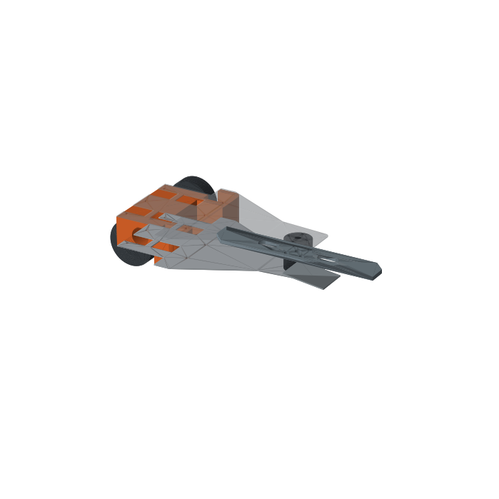

Unskinny Mk II is a ground-up redesign of a 2013 hobby spinner ([Unskinny Bot by lewisb42](https://www.instructables.com/Unskinny-Bot-3-lb-Horizontal-Spinner-Combat-Bot/)). It uses the layout that current competitive beetleweight spinners use. One parameter file drives everything:

```
params.py ──► CAD model (CadQuery) ──► STEP / STL / DXF manufacturing files
          ├─► physics models ───────► spin-up, energy, stress, drive, battery, gyro
          ├─► automated tests ──────► 12 pass/fail design checks
          └─► interactive page ─────► 3D viewer, stress map, design lab, fight simulator
```

Change a number in `params.py`, run `make`, and the model, simulations and checks all update.

---

## Screenshots

From the interactive demo ([`unskinny-mk2.html`](unskinny-mk2.html)).

| 3D model | Exploded view |
|---|---|
| 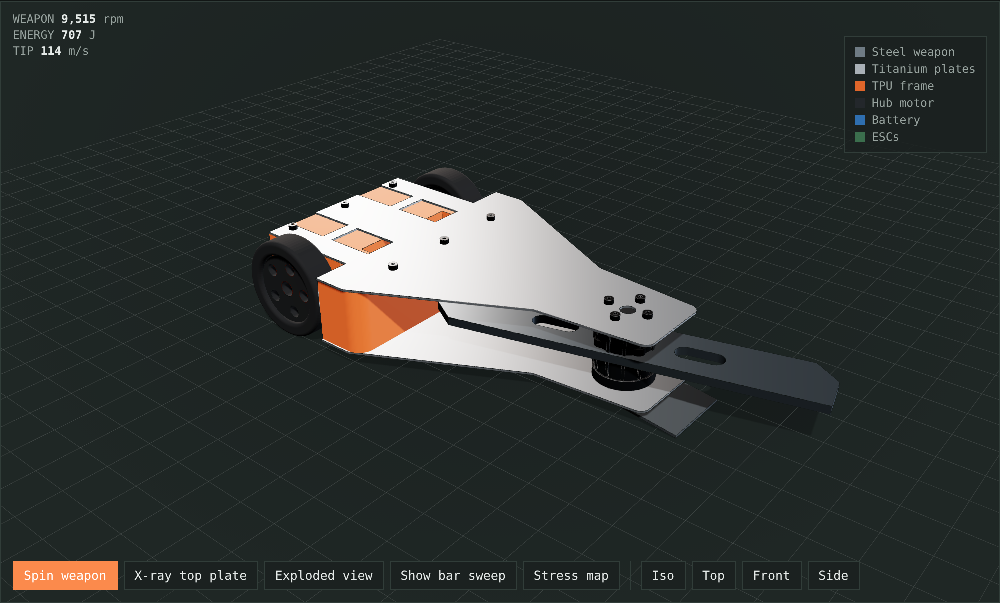 | 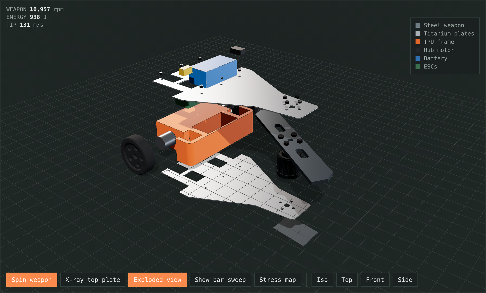 |
| **X-ray top plate**: hub motor, battery and speed controllers inside | **Stress map**: bar stress at full speed, highest at the bolt holes and slots |
| 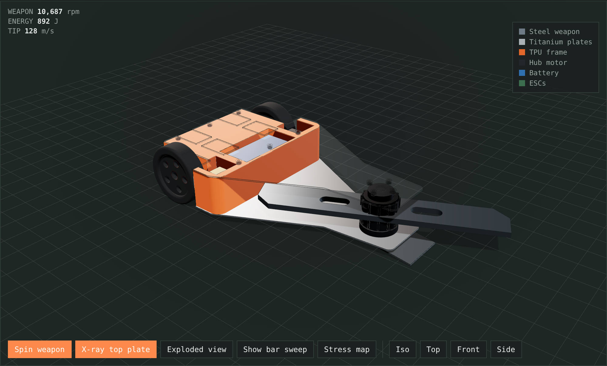 | 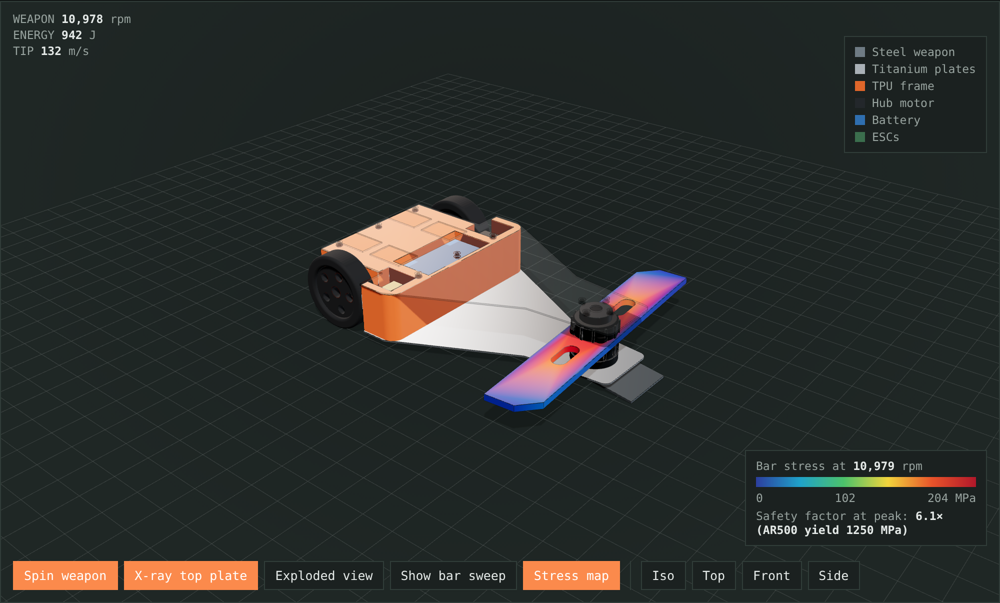 |
| **Bar sweep**: the weapon's circle clears the frame by 13.5 mm | **Side view** |
| 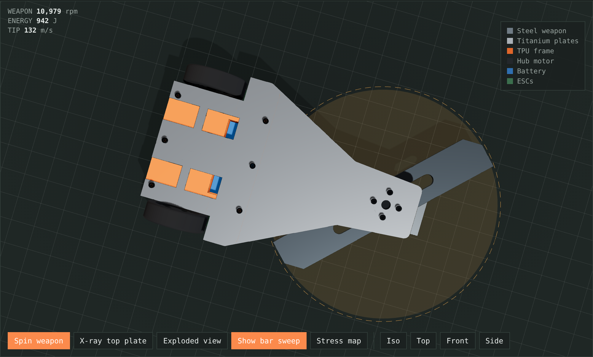 | 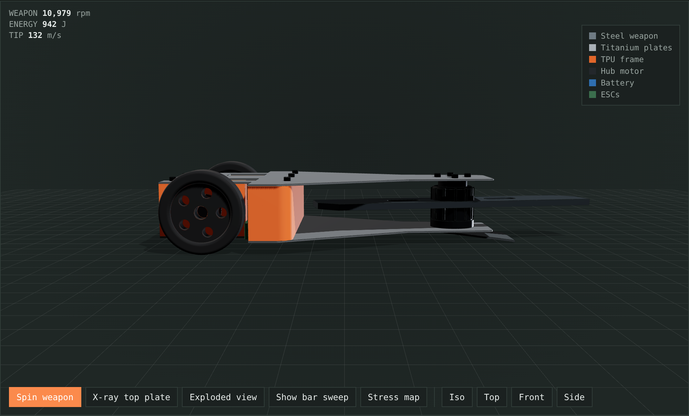 |

**Design lab**: change motor, battery and bar size, and the charts and numbers update live

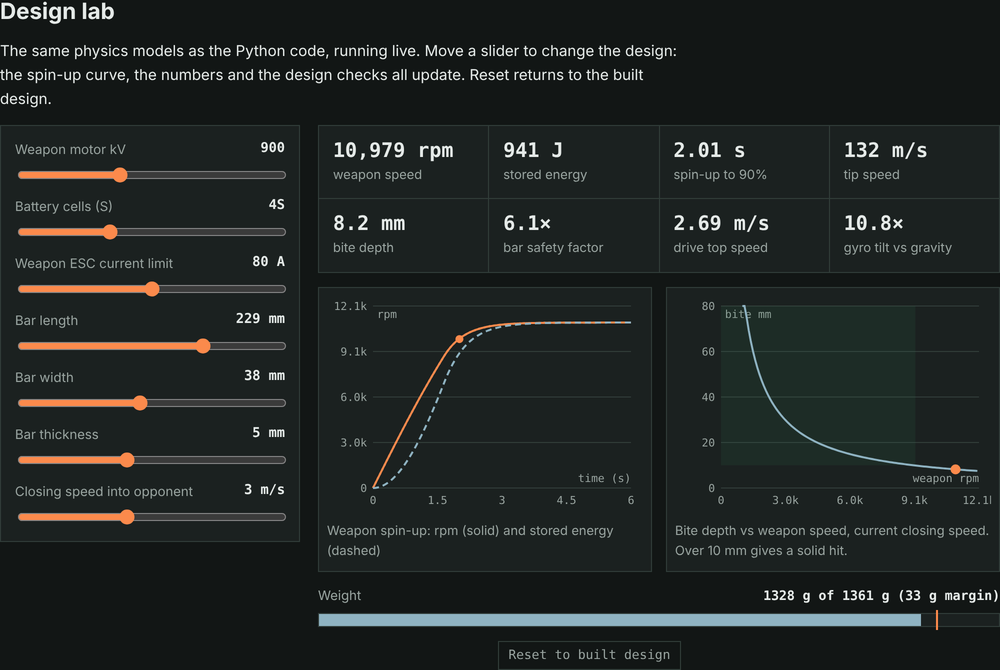

**Design checks**: geometry results from the CAD tests, physics checks recalculated live

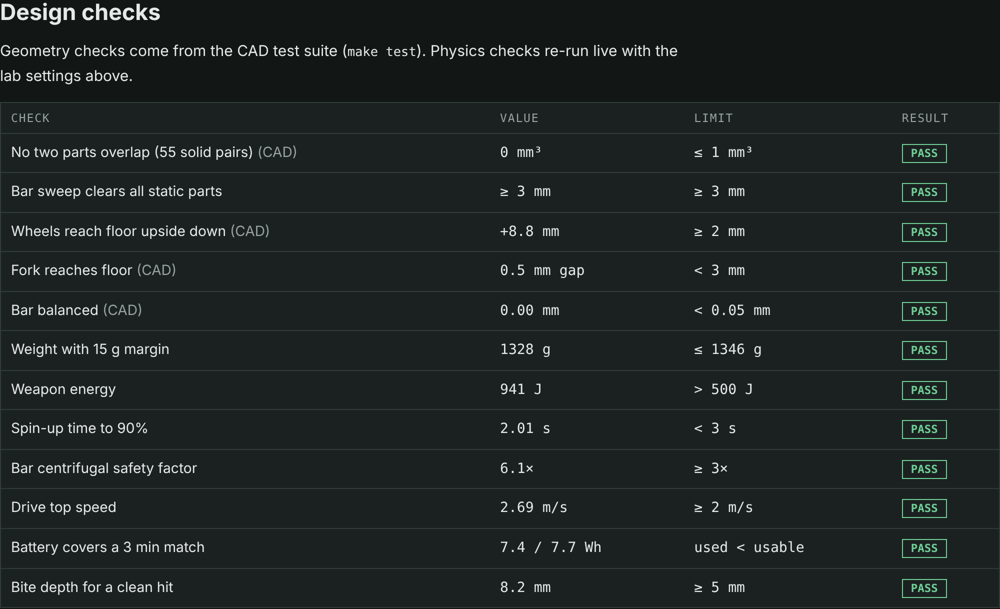

**Fight simulator**: real-time physics match against a vertical spinner, with health bars and a hit log

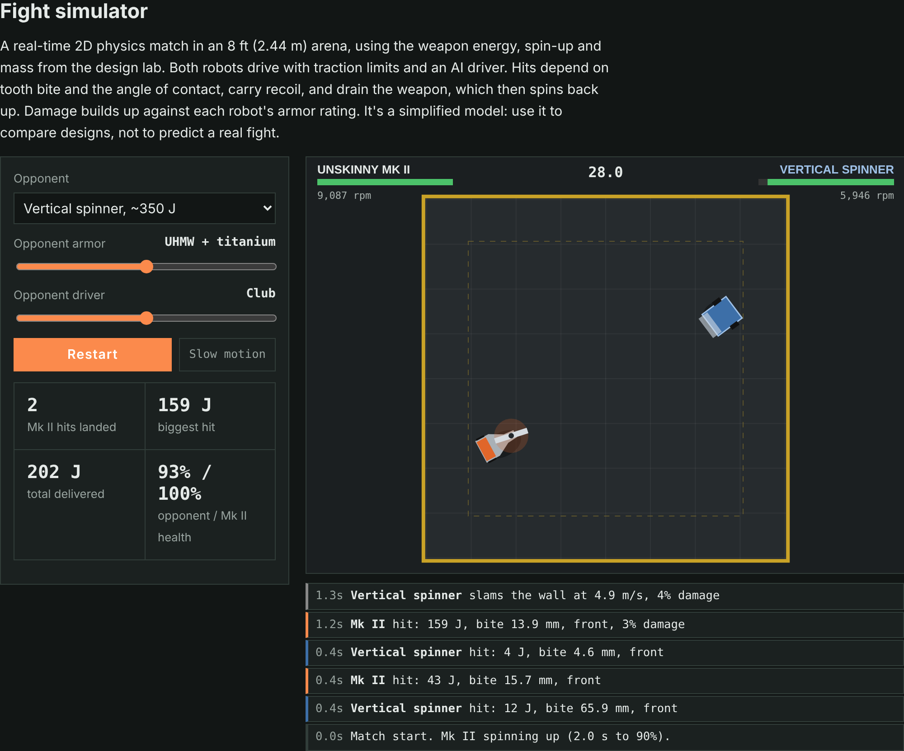

---

## Builder package

Everything a fabricator needs, in [`builder/Unskinny_MkII_Builder_Package.pdf`](builder/Unskinny_MkII_Builder_Package.pdf) (15 pages):
design upgrades, files list, bought and made parts, fasteners and torques, 5 dimensioned part drawings, wiring diagram, wire list and channel map, exploded assembly with numbered parts and steps, radio/speed-controller setup, test checks and safety.
Drawings are also in [`builder/drawings/`](builder/drawings) as SVG and PNG, and regenerate from the CAD with `python3 builder/drawings.py`, `builder/wiring.py` and `builder/assembly.py`.

| Wiring diagram | Exploded assembly |
|---|---|
| 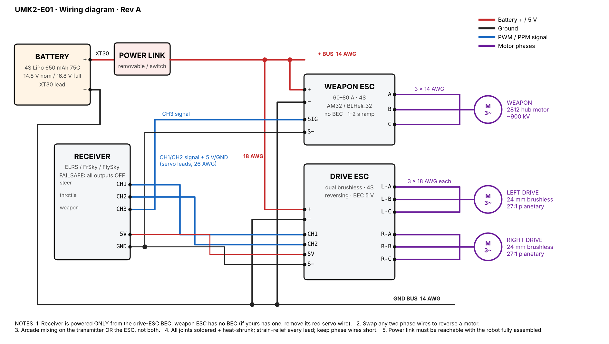 | 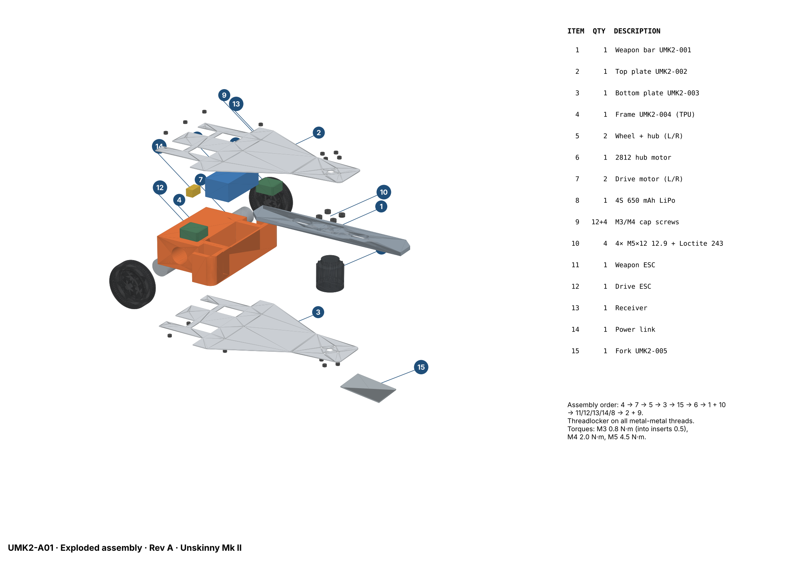 |

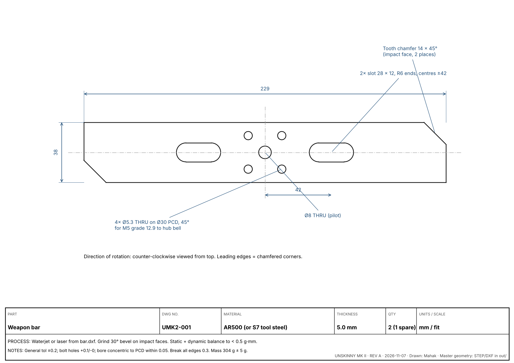

---

## Contents

1. [Builder package](#builder-package)
1. [Screenshots](#screenshots)
1. [Headline results](#headline-results)
2. [Interactive demo](#interactive-demo)
3. [Design](#design)
4. [Engineering analysis](#engineering-analysis)
5. [Automated design checks](#automated-design-checks)
6. [Engineering findings](#engineering-findings)
7. [Manufacturing files](#manufacturing-files)
8. [Bill of materials](#bill-of-materials)
9. [Build and test sequence](#build-and-test-sequence)
10. [Repository layout](#repository-layout)
11. [Running it](#running-it)
12. [Assumptions and limits](#assumptions-and-limits)
13. [References](#references)

---

## Headline results

All values come from `out/sim_summary.json`, generated by the code in this repo.

| Metric | Value |
|---|---|
| Total mass (CAD parts + bought parts) | **1,328 g**: 33 g under the 1,361 g limit |
| Weapon | 229 × 38 × 5 mm AR500 steel bar, 304 g, two teeth |
| Weapon speed | **~11,000 rpm** on 4S |
| Stored weapon energy | **~940 J** |
| Spin-up to 90% speed | **2.0 s** |
| Tip speed | 132 m/s |
| Peak bar stress / safety factor | 204 MPa / **6.1×** against AR500 yield (1,250 MPa) |
| Bite depth at 3 m/s closing | 8.2 mm |
| Drive top speed / acceleration | 2.7 m/s / 8.8 m/s² (limited by traction) |
| Energy used in a 3-minute match | 7.4 Wh of 7.7 Wh usable |
| Gyroscopic tilt when turning at full spin | 10.8× the gravity that holds it flat |

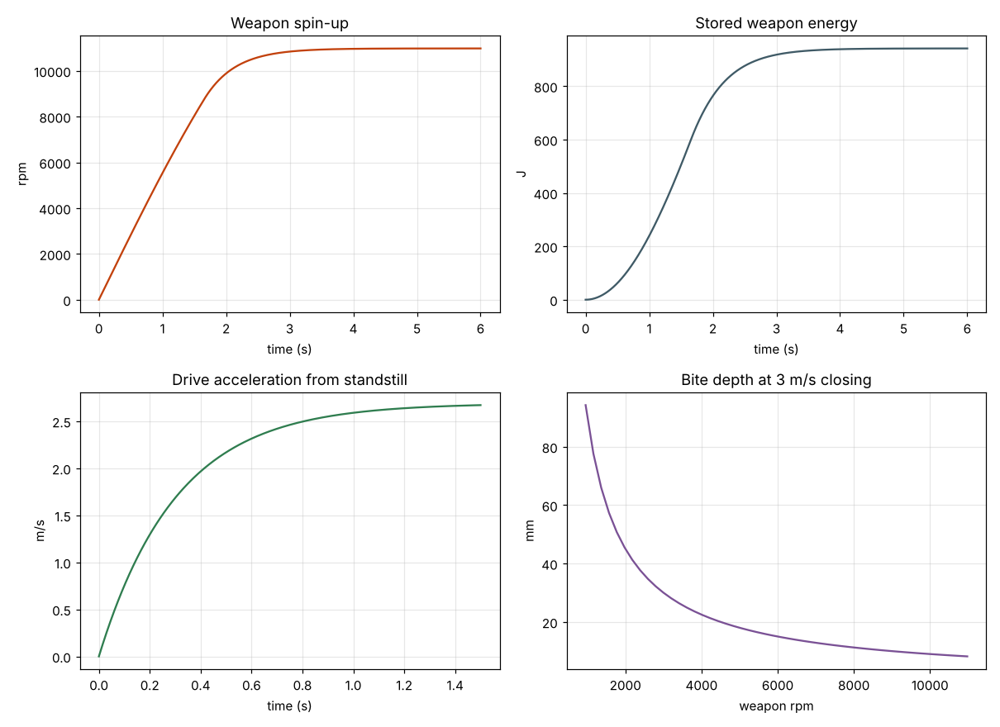

---

## Interactive demo

The demo page ([`showcase/index.html`](showcase/index.html), bundled as [`unskinny-mk2.html`](unskinny-mk2.html)) has five parts:

| Section | What it does |
|---|---|
| **3D viewer** | The full CAD assembly with bolts, motor, electronics and wheels. Orbit and zoom, hover a part for its material and mass, preset views (iso/top/front/side), see-through top plate, exploded view, bar-sweep overlay, and a live rpm/energy/tip-speed readout that follows the simulated spin-up. |
| **Stress map** | Colors the weapon bar by stress at the current weapon speed: the stress from spinning plus extra stress at bolt holes and slots. A color scale shows the peak stress and safety factor. |
| **Design lab** | Sliders for motor kV, battery cells, speed-controller current limit, bar length, width and thickness, and closing speed. The spin-up chart, bite chart, weight bar and 8 headline numbers update live. Values that differ from the built design are highlighted. |
| **Design checks** | 12 pass/fail checks. The 4 geometry checks show the CAD test results; the other 8 recalculate live from the design lab. |
| **Fight simulator** | A real-time 2D physics match in an 8 ft (2.44 m) arena. See below. |

### Fight simulator

- **Robots:** each has mass, rotational inertia, drive speed and traction limited by tire friction. A computer driver controls each one, and the opponent's skill can be set to novice, club or champion.
- **Mk II's weapon:** stores energy based on its inertia and spins up over the simulated time. Each hit delivers energy based on:
  - **tooth bite**: closing speed ÷ (teeth × revolutions per second), with full engagement at 10 mm or more;
  - **the face it hits**: angled wedge armor deflects most of the energy;
  - **the impact geometry**: the push is a mix of the tooth's direction of travel and straight outward.
- **After each hit:** both robots get equal and opposite pushes and spin, the weapon loses energy and spins back up, and the next tooth can only land after half a revolution.
- **Opponents:** box, wedge, vertical spinner (~350 J), drum (~280 J) and horizontal spinner (~420 J). Spinners strike back; vertical and drum spinners can launch Mk II into the air, and two horizontal spinners clash weapon-to-weapon.
- **Other effects:** wall slams cause damage above 3.5 m/s, a wedge can lift Mk II's wheels, and Mk II loses grip when gyroscopic force lifts a wheel in fast turns.
- **Damage:** builds up against armor ratings of 160, 300 or 520 J.
- **Display:** health bars, a 30-second match clock, sparks, a timestamped event log, slow motion, and a result (KO, win on damage, or draw).

Across 300 batch-simulated matches (20 per opponent and armor level), outcomes vary sensibly. Mk II knocks out a thinly armored box in about 4 s, but usually loses on damage to a steel-armored wedge, which deflects horizontal hits.

---

## Design

### Mk I to Mk II

| | Mk I (2013) | Mk II |
|---|---|---|
| Weapon drive | Belt, 16T:42T pulleys, no tensioner | **Direct-drive 2812 brushless hub motor**, bar bolted to the motor's spinning outer shell |
| Weapon | 6 in aluminum bar | 229 × 38 × 5 mm **AR500 steel** with slots near the hub to save weight |
| Weapon energy | ~60 J (estimate) | **~940 J** |
| Drive | Brushed B16 gearmotors | 24 mm **brushless planetary**, 27:1 |
| Power | 3S 1000 mAh LiPo | **4S** 650 mAh LiPo |
| Structure | CNC-milled aluminum + UHMW plastic | **1.2 mm Ti-6Al-4V** plates + **3D-printed TPU** frame that absorbs hits |
| Works upside down | No | **Yes**: wheels stick out 8.8 mm past both plates |
| Design method | SketchUp, hand-measured | Parametric code, simulation and automated checks |

### Layout

- **Weapon:** the hub motor sits on the weapon axis (the origin of the model), clamped between the top and bottom plates. The bar spins in the 40 mm gap between the plates and sticks out past the front and sides.
- **Plates:** narrow "tongue" plates carry the motor, which keeps weight off the area the bar sweeps through.
- **Rear pod:** the printed TPU frame sits 13.5 mm outside the bar's circle. It holds the battery (mounted sideways), the two speed controllers in their own bays, and the two drive motors and wheels.
- **Fork:** a titanium wedge under the front of the bottom plate reaches down to the floor to scoop opponents into the weapon.

| Top | Front |
|---|---|
| 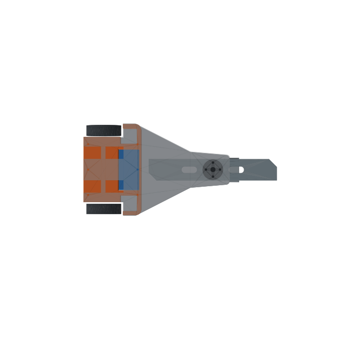 | 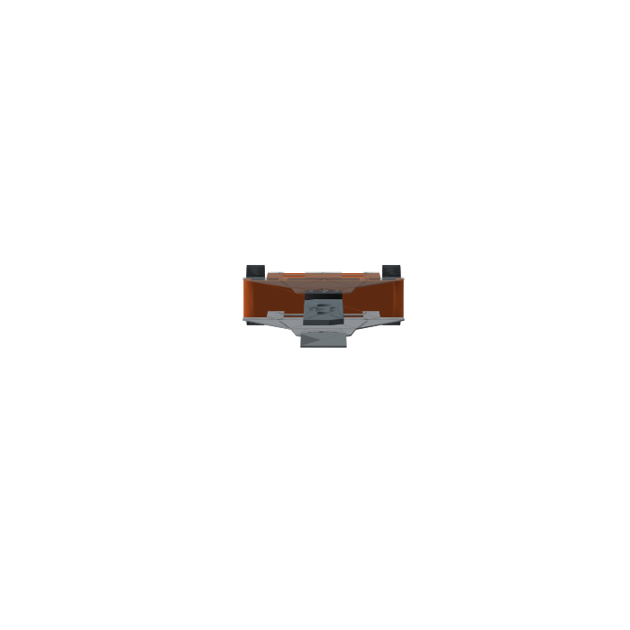 |

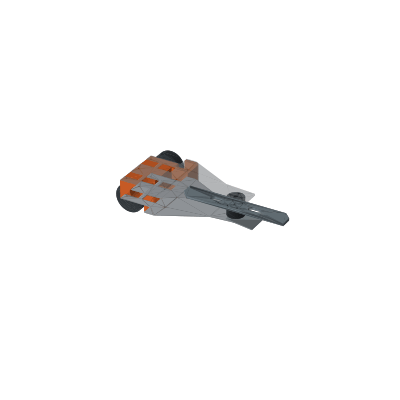

---

## Engineering analysis

All models are in [`sim/models.py`](sim/models.py). The functions take inputs and return results with no side effects, so the tests can call them directly.

| Model | Method |
|---|---|
| **Weapon inertia** | Taken from the CAD solid (CadQuery's inertia calculation × steel density) plus the motor's spinning shell (estimated 0.30 kg·cm²). Bar: 13.9 kg·cm². |
| **Spin-up** | Brushless motor modeled as a DC motor (back-EMF from kV, winding resistance) with a speed-controller current limit and air drag (τ = c·ω²), solved with SciPy `solve_ivp`. |
| **Stored energy** | E = ½·I·ω² |
| **Bar stress** | Stress in a spinning bar, σ = ρω²R²/2 at the center, × 3 for the bolt holes, compared with AR500 yield. |
| **Bite** | bite = v_closing / (teeth × rev/s) |
| **Drive** | Top speed from kV × voltage × efficiency ÷ gear ratio. Acceleration is the smaller of motor force and tire grip (μ = 0.9). |
| **Gyroscopic tilt** | (I·ω·turn rate) / (m·g·half track width) |
| **Match energy** | 8 full spin-ups at 60% efficiency + 25 W to keep the weapon spinning + 4 A average drive draw, over 180 s |

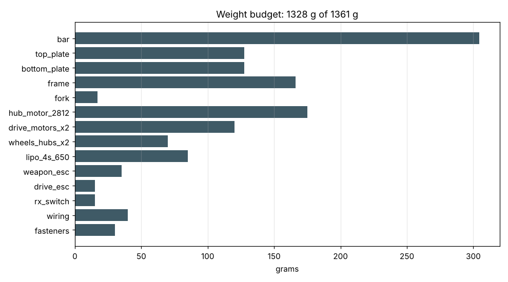

---

## Automated design checks

`make test` runs [`tests/test_design.py`](tests/test_design.py) against the actual CAD geometry and the physics models. All 12 pass.

| # | Check | Requirement |
|---|---|---|
| 1 | No part overlaps another (55 pairs checked as solid intersections) | ≤ 1 mm³ overlap |
| 2 | Bar sweep clears every non-moving part | ≥ 3 mm clearance |
| 3 | Wheels reach the floor upside down | ≥ 2 mm past the plates |
| 4 | Fork reaches the floor | within 3 mm |
| 5 | Weight limit with margin | ≤ 1,346 g |
| 6 | Bar balanced | center of mass < 0.05 mm off the axis |
| 7 | Weapon energy and spin-up | > 500 J, < 3 s to 90% |
| 8 | Bar strength | safety factor ≥ 3 |
| 9 | Drive | ≥ 2 m/s and limited by traction |
| 10 | Battery | match energy < usable energy |
| 11 | Spin-up solver | reaches theoretical no-load speed within 1% |
| 12 | Energy formula | unit check |

The overlap check was itself tested: a part placed on purpose to clash with the frame is caught (8,000 mm³ overlap reported).

---

## Engineering findings

1. **The first concept was 444 g over the weight limit.** The CAD mass check showed that a 229 × 50 × 9.5 mm steel bar weighs 773 g and full-width titanium plates about 400 g each. The fixes:
   - a 5 mm bar with slots near the hub, which keeps the weight at the tips where it stores the most energy;
   - tapered "tongue" plates;
   - pockets cut out of the plates;
   - 45% infill on the printed frame.

   Result: 33 g under the limit, still with about 940 J of weapon energy.
2. **Gyroscopic lift is about 11× gravity in fast turns.** The robot will lift a wheel when turning hard at full weapon speed. All horizontal spinners have this problem. The answer is to turn gently at full spin and keep the wheels wide apart. The fight simulator models the lost grip.
3. **The battery is barely big enough** (7.4 of 7.7 Wh). If testing confirms this, an 850 mAh pack (about 25 g more) still fits under the weight limit.
4. **Bite is short at full speed** (8.2 mm at 3 m/s). Driving into the opponent faster, or hitting while the weapon is still spinning up, gives a solid hit. The bite chart in the design lab shows this.

---

## Manufacturing files

Generated in `out/` by `make cad`.

| File | Process |
|---|---|
| `bar.dxf`, `bar.step` | Waterjet or laser cut from 5 mm AR500, then grind a bevel on the teeth and balance |
| `top_plate.dxf`, `bottom_plate.dxf` (+ `.step`) | Laser or waterjet cut from 1.2 mm grade 5 titanium (e.g. SendCutSend, OSH Cut) |
| `frame.stl`, `frame.step` | 3D print in TPU 95A, 4–6 walls, ~45% gyroid infill, with heat-set threaded inserts |
| `fork.stl` | Cut and bend from 1.5 mm titanium |
| `unskinny_mk2_assembly.step` | Full assembly; opens in Fusion 360, FreeCAD, Onshape and SolidWorks |
| `cad_report.json` | Mass of each part and the bar's inertia |

---

## Bill of materials

| Qty | Part | Example | Mass (g) |
|---|---|---|---|
| 1 | Weapon hub motor, 2812 | [Repeat Robotics 2812 Battle Ready Beetle Hubmotor](https://palmbeachbots.com/products/repeat-robotics-2812-battle-ready-beetle-hubmotor) | 175 |
| 2 | Brushless planetary drive motor | [Repeat Robotics Max V2 24 mm, 27:1](https://reach.dog/shop/palm-beach-bots/products/repeat-robotics-max-v2-24mm-brushless-planetary-motor-beetle-drive) | 120 (pair) |
| 1 | Weapon speed controller, 60–80 A, 4S | AM32 / BLHeli_32 | 35 |
| 1 | Dual brushless drive speed controller, 4S, reversing | Repeat / DualSky combat ESC | 15 |
| 1 | Receiver with failsafe | to match your transmitter (FlySky, FrSky, ELRS) | ~5 |
| 1 | Power switch or removable link | Fingertech switch or XT30 link | ~10 |
| 3 | 4S 650 mAh LiPo, 75C+ | GNB, CNHL, Tattu | 85 each |
| 2 | 62 mm drive wheels + hubs | Fingertech Viper or cast urethane | 70 (pair) |
| 1 | Weapon bar | AR500, from `bar.dxf` | 304.5 |
| 2 | Top and bottom plates | Ti-6Al-4V 1.2 mm, from DXF | 255.2 (pair) |
| 1 | Frame | TPU 95A, from `frame.stl` | 166.0 |
| 1 | Fork | Ti-6Al-4V 1.5 mm | 17.0 |
| — | Fasteners, wire | grade 12.9 M3/M4/M5 screws, 14–16 AWG silicone wire, XT30 | 70 |
| | **Total** | | **1,327.7** |

---

## Build and test sequence

1. Download the STEP files for the bought parts ([Repeat Robotics on GrabCAD](https://cad.grabcad.com/repeat.robotics-1/models?page=1)) and check they fit the model.
2. Order the cut metal parts from the DXFs (two of each) and print the frame.
3. Assemble:
   - drive motors and wheels into the frame;
   - hub motor between the plates;
   - bar onto the motor's spinning shell with grade 12.9 M5 screws and threadlocker.
4. Wire up, then pack the battery and speed controllers in foam.
5. Weigh every part and enter the real numbers in `params.py`, then run `make` again.
6. Testing:
   - bind the receiver and set the failsafe to motors off, then check it;
   - drive test with the bar removed;
   - spin up the weapon in steps (25 / 50 / 100%) inside a test box;
   - measure the real rpm and compare it with the simulation;
   - run a full 3-minute session and check temperatures.
7. **Safety:** a 940 J steel bar can seriously injure people. Only spin it inside an enclosure, and charge LiPos in a fireproof bag.

The printable build pack with checklists is at [`showcase/build-pack.html`](showcase/build-pack.html).

---

## Repository layout

```
params.py                  all dimensions, materials, motor and battery data
cad/build.py               CadQuery model: parts, assembly, STEP/STL/DXF export, mass & inertia report
sim/models.py              physics models (spin-up ODE, energy, stress, bite, drive, gyro, battery)
sim/plots.py               plots, 3D renders, spinning demo GIF
tests/test_design.py       12 automated design checks (geometry + physics)
showcase/index.html        interactive page: 3D viewer, stress map, design lab, fight simulator
showcase/model.json        meshes and part info for the viewer
showcase/build-pack.html   build checklists, weight budget, weapon calculator
tools/build_standalone.py  bundles the page into one offline HTML file
unskinny-mk2.html          the bundled offline page
docs/index.html            same page, served by GitHub Pages
out/                       generated CAD, manufacturing files, images, results
Makefile                   make cad | make sim | make test | make (all)
```

## Running it

```bash
pip install -r requirements.txt
```

```bash
make
```

`make` builds the CAD, runs the simulations and runs the tests. You can also run each step on its own:

```bash
make cad
```

```bash
make sim
```

```bash
make test
```

To rebuild the offline page after changing the showcase, pass the path to an unpacked `three@0.128.0` npm package:

```bash
python3 tools/build_standalone.py path/to/three-package
```

Requires Python 3.10+, CadQuery 2.8, NumPy, SciPy, Matplotlib, trimesh and pytest.

---

## Assumptions and limits

- **Estimated values:** motor kV (900), winding resistance (0.045 Ω), the motor shell's inertia, drive motor and wheel masses, and air drag are datasheet-level estimates. Update `params.py` once the parts arrive; the tests will flag anything that no longer fits.
- **Stand-in shapes:** bought parts (motors, speed controllers, battery, wheels) are simplified shapes with the right outer size. Their masses come from the bill of materials, not the CAD.
- **Stress:** the stress analysis is a closed-form calculation with a hole factor, not a full finite-element analysis. Impact loads are not included.
- **Fight simulator:** it's a simplified 2D model for comparing designs. It doesn't predict real matches.
- **Rules:** check your event's rules for weapon tip-speed limits, LiPo rules and failsafe requirements.

## References

- Original design: [Unskinny Bot: 3-lb Horizontal Spinner Combat Bot (lewisb42, Instructables)](https://www.instructables.com/Unskinny-Bot-3-lb-Horizontal-Spinner-Combat-Bot/)
- Competition context: [NHRL 2025 Championships, 3 lb qualifiers](https://wiki.nhrl.io/wiki/index.php?title=2025_Championships) · [Caldera / Actual Size (NHRL wiki)](https://wiki.nhrl.io/wiki/index.php?title=Actual_Size) · [Silent Spring (NHRL wiki)](https://wiki.nhrl.io/wiki/index.php/Silent_Spring) · [National Havoc Robot League](https://en.wikipedia.org/wiki/National_Havoc_Robot_League)
- Components: [Repeat Robotics 2812 hub motor](https://palmbeachbots.com/products/repeat-robotics-2812-battle-ready-beetle-hubmotor) · [Repeat Robotics Max V2 drive](https://reach.dog/shop/palm-beach-bots/products/repeat-robotics-max-v2-24mm-brushless-planetary-motor-beetle-drive) · [Repeat Robotics CAD models](https://cad.grabcad.com/repeat.robotics-1/models?page=1)
- Weapon design: [Ask Aaron: spinner weapon Q&A](https://runamok.tech/AskAaron/weapon.html)
- Tools: [CadQuery](https://github.com/CadQuery/cadquery) · [three.js](https://threejs.org/) · [SciPy](https://scipy.org/) · [trimesh](https://trimesh.org/)

## Author

Mahak ([@mahak867](https://github.com/mahak867))
